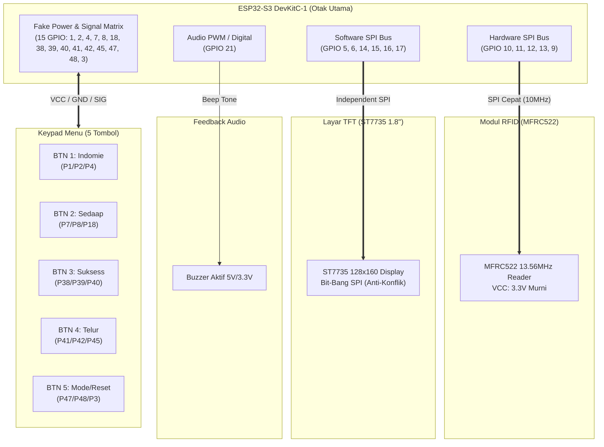

# 🔌 Skema Wiring & Visualisasi Pin ESP32-S3 (NBPay EDC)

Dokumen ini memuat diagram visual arsitektur perangkat keras, denah pinout board ESP32-S3 DevKitC-1, diagram blok perkabelan untuk setiap modul, serta panduan kode warna kabel jumper (*jumper wire color coding*).

---

## 🗺️ 1. Diagram Arsitektur Sistem

Diagram berikut mengilustrasikan pembagian bus dan jalur koneksi antara ESP32-S3 dan modul periferal:



---

## 📍 2. Visual Pinout Board ESP32-S3 (Header J1 & J3)

Berikut adalah peta fisik letak pin pada board ESP32-S3 DevKitC-1 dengan label modul yang terhubung:

```text
                        ┌────────────────────────┐
                        │     [ TYPE-C USB ]     │
                        │       ESP32-S3         │
                        │      DevKitC-1         │
                        │                        │
       [TFT]      3V3  ─┤ 1                   44 ├─  GND     [POWER]
       [TFT/RFID] 3V3  ─┤ 2                   43 ├─  TX/IO43
       [SYSTEM]   EN   ─┤ 3                   42 ├─  RX/IO44
       [BTN 1]    IO4  ─┤ 4  [J1]       [J3]  41 ├─  IO1     [BTN 1] (Fake VCC)
       [TFT]      IO5  ─┤ 5                   40 ├─  IO2     [BTN 1] (Fake GND)
       [TFT]      IO6  ─┤ 6                   39 ├─  IO42    [BTN 4] (Fake GND)
       [BTN 2]    IO7  ─┤ 7                   38 ├─  IO41    [BTN 4] (Fake VCC)
       [TFT]      IO15 ─┤ 8                   37 ├─  IO40    [BTN 3] (SIG)
       [TFT]      IO16 ─┤ 9                   36 ├─  IO39    [BTN 3] (Fake GND)
       [TFT]      IO17 ─┤ 10                  35 ├─  IO38    [BTN 3] (Fake VCC)
       [BTN 2]    IO18 ─┤ 11                  34 ├─  IO37
       [BTN 2]    IO8  ─┤ 12                  33 ├─  IO36
       [BTN 5]    IO3  ─┤ 13                  32 ├─  IO35
                  IO46 ─┤ 14                  31 ├─  IO0
       [RFID]     IO9  ─┤ 15                  30 ├─  IO45    [BTN 4] (SIG)
       [RFID]     IO10 ─┤ 16                  29 ├─  IO48    [BTN 5] (Fake GND)
       [RFID]     IO11 ─┤ 17                  28 ├─  IO47    [BTN 5] (Fake VCC)
       [RFID]     IO12 ─┤ 18                  27 ├─  IO21    [BUZZER] (SIG)
       [RFID]     IO13 ─┤ 19                  26 ├─  IO20
       [TFT]      IO14 ─┤ 20                  25 ├─  IO19
       [POWER]    5V   ─┤ 21                  24 ├─  GND     [POWER]
       [POWER]    GND  ─┤ 22                  23 ├─  GND     [POWER]
                        └────────────────────────┘
```

---

## 🔍 3. Diagram Koneksi Per Modul

### 3.1. Modul RFID-RC522 (Hardware SPI)
Menggunakan Hardware SPI internal ESP32-S3. Modul ini wajib mendapat tegangan **3.3V stabil**.

```text
 ┌─────────────────┐                       ┌──────────────────┐
 │  MFRC522 RFID   │                       │  ESP32-S3 BOARD  │
 │                 │                       │                  │
 │      SDA (SS/CS)├───────[ Biru ]───────>│ GPIO 10          │
 │             SCK ├──────[ Kuning ]──────>│ GPIO 12          │
 │            MOSI ├───────[ Hijau ]──────>│ GPIO 11          │
 │            MISO ├───────[ Putih ]──────>│ GPIO 13          │
 │             RST ├───────[ Ungu ]───────>│ GPIO 9           │
 │            3.3V ├───────[ Merah ]──────>│ 3V3              │
 │             GND ├───────[ Hitam ]──────>│ GND              │
 └─────────────────┘                       └──────────────────┘
```

| Pin RC522 | Pin ESP32-S3 | Warna Kabel | Keterangan |
| :--- | :--- | :--- | :--- |
| **SDA / SS / CS** | **GPIO 10** | 🔵 Biru | Chip Select SPI |
| **SCK** | **GPIO 12** | 🟡 Kuning | SPI Clock Bus |
| **MOSI** | **GPIO 11** | 🟢 Hijau | Master Out Slave In |
| **MISO** | **GPIO 13** | ⚪ Putih | Master In Slave Out |
| **RST** | **GPIO 9** | 🟣 Ungu | Hardware Reset |
| **3.3V** | **3V3** | 🔴 Merah | Daya 3.3 Volt |
| **GND** | **GND** | ⚫ Hitam | Ground Tegangan |

---

### 3.2. Modul Layar TFT ST7735 1.8" (Software SPI)
Menggunakan **Bit-Bang SPI** (pin independen) agar transfer data LCD berkecepatan tinggi tidak mengganggu atau bentrok dengan pembacaan kartu NFC.

```text
 ┌─────────────────┐                       ┌──────────────────┐
 │  ST7735 1.8"    │                       │  ESP32-S3 BOARD  │
 │                 │                       │                  │
 │        SDA/MOSI ├───────[ Hijau ]──────>│ GPIO 5           │
 │         SCK/SCL ├──────[ Kuning ]──────>│ GPIO 6           │
 │              CS ├───────[ Biru ]───────>│ GPIO 14          │
 │         RES/RST ├───────[ Ungu ]───────>│ GPIO 15          │
 │           DC/A0 ├───────[ Putih ]──────>│ GPIO 16          │
 │         BLK/LED ├──────[ Orange ]──────>│ GPIO 17          │
 │             VCC ├───────[ Merah ]──────>│ 3V3 / 5V         │
 │             GND ├───────[ Hitam ]──────>│ GND              │
 └─────────────────┘                       └──────────────────┘
```

| Pin ST7735 | Pin ESP32-S3 | Warna Kabel | Keterangan |
| :--- | :--- | :--- | :--- |
| **SDA / MOSI** | **GPIO 5** | 🟢 Hijau | Data Display |
| **SCL / SCK** | **GPIO 6** | 🟡 Kuning | Clock Display |
| **CS** | **GPIO 14** | 🔵 Biru | Chip Select TFT |
| **RES / RST** | **GPIO 15** | 🟣 Ungu | Reset Hardware TFT |
| **DC / A0** | **GPIO 16** | ⚪ Putih | Data / Command Selector |
| **BLK / LED** | **GPIO 17** | 🟠 Orange | Backlight Kontrol |
| **VCC** | **3V3 / 5V** | 🔴 Merah | Power (5V direkomendasikan bila backlight redup) |
| **GND** | **GND** | ⚫ Hitam | Ground Tegangan |

---

### 3.3. Modul Active Buzzer
Buzzer aktif menghasilkan bunyi *feedback* transaksi (nada konfirmasi sukses/gagal).

```text
 ┌─────────────────┐                       ┌──────────────────┐
 │  Active Buzzer  │                       │  ESP32-S3 BOARD  │
 │                 │                       │                  │
 │         I/O/SIG ├──────[ Cokelat ]─────>│ GPIO 21          │
 │             VCC ├───────[ Merah ]──────>│ 3V3 / 5V         │
 │             GND ├───────[ Hitam ]──────>│ GND              │
 └─────────────────┘                       └──────────────────┘
```

| Pin Buzzer | Pin ESP32-S3 | Warna Kabel | Keterangan |
| :--- | :--- | :--- | :--- |
| **I/O / SIG** | **GPIO 21** | 🟤 Cokelat | Kontrol Sinyal Audio |
| **VCC** | **3V3 / 5V** | 🔴 Merah | Power |
| **GND** | **GND** | ⚫ Hitam | Ground |

---

### 3.4. Keypad 5-Tombol (Konfigurasi Fake Power Rail)

Karena board ESP32-S3 hanya menyediakan sedikit pin fisik `3.3V` dan `GND`, kita menerapkan teknik **Fake Power**:
- **Fake VCC**: Pin GPIO difungsikan sebagai `OUTPUT` bernilai `HIGH` (+3.3V konstan).
- **Fake GND**: Pin GPIO difungsikan sebagai `OUTPUT` bernilai `LOW` (0V konstan).
- **OUT / SIG**: Pin GPIO input dengan `INPUT_PULLDOWN` untuk membaca tekanan tombol.

```text
                     SKEMA FAKE POWER PADA TOMBOL
             ESP32 GPIO (Fake VCC - HIGH) ───┐
                                             │
                                     ┌───────┴──────┐
                                     │  PUSH BUTTON │
                     ESP32 GPIO ◄────┤  [OUT / SIG] │
                     (Input Signal)  │              │
                                     └───────┬──────┘
                                             │
             ESP32 GPIO (Fake GND - LOW)  ───┘
```

#### Rincian Pin Tombol 1 s/d 5:

```text
  [TOMBOL 1: Indomie]       [TOMBOL 2: Sedaap]        [TOMBOL 3: Suksess]
┌─────────────────────┐   ┌─────────────────────┐   ┌─────────────────────┐
│ VCC : GPIO 1 (HIGH) │   │ VCC : GPIO 7 (HIGH) │   │ VCC : GPIO 38(HIGH) │
│ GND : GPIO 2 (LOW)  │   │ GND : GPIO 8 (LOW)  │   │ GND : GPIO 39(LOW)  │
│ OUT : GPIO 4 (SIG)  │   │ OUT : GPIO 18(SIG)  │   │ OUT : GPIO 40(SIG)  │
└─────────────────────┘   └─────────────────────┘   └─────────────────────┘

        [TOMBOL 4: Telur]         [TOMBOL 5: Mode/Reset]
      ┌─────────────────────┐   ┌─────────────────────┐
      │ VCC : GPIO 41(HIGH) │   │ VCC : GPIO 47(HIGH) │
      │ GND : GPIO 42(LOW)  │   │ GND : GPIO 48(LOW)  │
      │ OUT : GPIO 45(SIG)  │   │ OUT : GPIO 3 (SIG)  │
      └─────────────────────┘   └─────────────────────┘
```

| Modul Tombol | Fungsi Menu | Pin VCC (Fake) | Pin GND (Fake) | Pin OUT (Sinyal) |
| :--- | :--- | :--- | :--- | :--- |
| **Tombol 1** | Indomie (Rp 6.000) | **GPIO 1** | **GPIO 2** | **GPIO 4** |
| **Tombol 2** | Sedaap (Rp 6.000) | **GPIO 7** | **GPIO 8** | **GPIO 18** |
| **Tombol 3** | Suksess (Rp 8.000) | **GPIO 38** | **GPIO 39** | **GPIO 40** |
| **Tombol 4** | Telur (Rp 2.000) | **GPIO 41** | **GPIO 42** | **GPIO 45** |
| **Tombol 5** | Mode / Reset | **GPIO 47** | **GPIO 48** | **GPIO 3** *(Pengganti Pin 0)* |

---

## 📋 4. Tabel Master GPIO ESP32-S3 (Sorted by GPIO)

Tabel ini memudahkan inspeksi saat menggunakan multimeter atau *logic analyzer*:

| GPIO ESP32-S3 | Header Board | Modul Terhubung | Pin Komponen | Tipe Sinyal |
| :---: | :---: | :--- | :--- | :--- |
| **GPIO 1** | J3 (Pin 41) | Keypad Tombol 1 | VCC | Digital OUT (HIGH 3.3V) |
| **GPIO 2** | J3 (Pin 40) | Keypad Tombol 1 | GND | Digital OUT (LOW 0V) |
| **GPIO 3** | J1 (Pin 13) | Keypad Tombol 5 | OUT / SIG | Digital IN |
| **GPIO 4** | J1 (Pin 4) | Keypad Tombol 1 | OUT / SIG | Digital IN |
| **GPIO 5** | J1 (Pin 5) | Layar ST7735 | SDA / MOSI | Soft-SPI Data OUT |
| **GPIO 6** | J1 (Pin 6) | Layar ST7735 | SCK / SCL | Soft-SPI Clock OUT |
| **GPIO 7** | J1 (Pin 7) | Keypad Tombol 2 | VCC | Digital OUT (HIGH 3.3V) |
| **GPIO 8** | J1 (Pin 12) | Keypad Tombol 2 | GND | Digital OUT (LOW 0V) |
| **GPIO 9** | J1 (Pin 15) | RFID MFRC522 | RST | Digital OUT |
| **GPIO 10** | J1 (Pin 16) | RFID MFRC522 | SDA / SS | Hard-SPI CS OUT |
| **GPIO 11** | J1 (Pin 17) | RFID MFRC522 | MOSI | Hard-SPI MOSI OUT |
| **GPIO 12** | J1 (Pin 18) | RFID MFRC522 | SCK | Hard-SPI Clock OUT |
| **GPIO 13** | J1 (Pin 19) | RFID MFRC522 | MISO | Hard-SPI MISO IN |
| **GPIO 14** | J1 (Pin 20) | Layar ST7735 | CS | Digital OUT (TFT CS) |
| **GPIO 15** | J1 (Pin 8) | Layar ST7735 | RES / RST | Digital OUT (TFT Reset) |
| **GPIO 16** | J1 (Pin 9) | Layar ST7735 | DC / A0 | Digital OUT (TFT Command) |
| **GPIO 17** | J1 (Pin 10) | Layar ST7735 | BLK / LED | Digital OUT (Backlight) |
| **GPIO 18** | J1 (Pin 11) | Keypad Tombol 2 | OUT / SIG | Digital IN |
| **GPIO 21** | J3 (Pin 27) | Active Buzzer | I/O / SIG | Digital OUT / Tone |
| **GPIO 38** | J3 (Pin 35) | Keypad Tombol 3 | VCC | Digital OUT (HIGH 3.3V) |
| **GPIO 39** | J3 (Pin 36) | Keypad Tombol 3 | GND | Digital OUT (LOW 0V) |
| **GPIO 40** | J3 (Pin 37) | Keypad Tombol 3 | OUT / SIG | Digital IN |
| **GPIO 41** | J3 (Pin 38) | Keypad Tombol 4 | VCC | Digital OUT (HIGH 3.3V) |
| **GPIO 42** | J3 (Pin 39) | Keypad Tombol 4 | GND | Digital OUT (LOW 0V) |
| **GPIO 45** | J3 (Pin 30) | Keypad Tombol 4 | OUT / SIG | Digital IN |
| **GPIO 47** | J3 (Pin 28) | Keypad Tombol 5 | VCC | Digital OUT (HIGH 3.3V) |
| **GPIO 48** | J3 (Pin 29) | Keypad Tombol 5 | GND | Digital OUT (LOW 0V) |

---

> ⚠️ **Catatan Penting Saat Perakitan:**
> 1. Modul RFID **wajib** disambungkan ke pin `3V3` ESP32-S3 (Toleransi RFID RC522 adalah 3.3V, jangan sambung ke 5V).
> 2. Backlight ST7735 (`BLK`) dapat langsung dihubungkan ke `GPIO 17` karena konsumsi arusnya kecil (~15mA) dan dapat dipadamkan secara otomatis via software di malam hari.
> 3. Skema *Fake Power* pada tombol aman 100% karena arus tekan tombol mikro-ampere, jauh di bawah batas maksimum per-pin GPIO ESP32-S3 (40mA).
